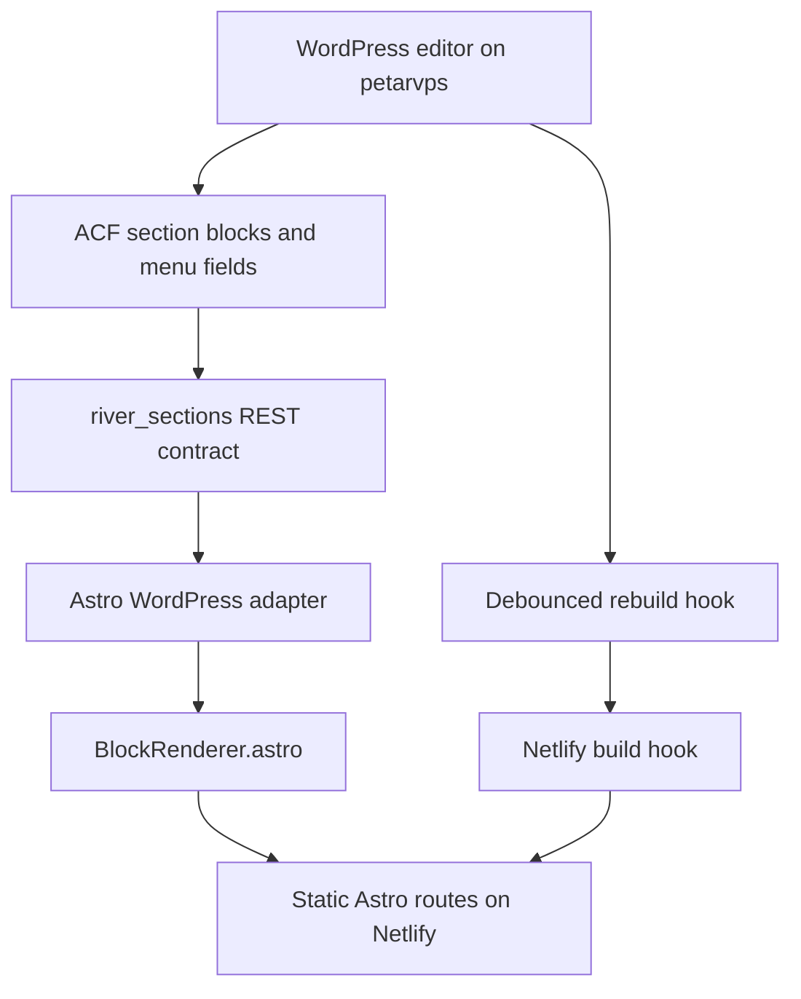

# WordPress Astro Migration - Plan

## Goal Capsule

| Field | Value |
|---|---|
| Objective | River's public website is rebuilt as a headless WordPress-authored site where restaurant staff can edit page sections and menus while Netlify serves a static Astro frontend. |
| Means | Create the new implementation under `new/`, model each page section as a WordPress block/ACF section, render those blocks through Astro, host WordPress on `petarvps`, and keep Netlify as the frontend build host. |
| Authority | User request, current React site content, and the NUS WordPress + Astro block-renderer pattern are the primary constraints. Official Astro, WordPress REST, ACF Blocks, and Netlify docs govern integration details where the local pattern needs current platform behavior. |
| Execution profile | Deep software migration with frontend, CMS, content migration, hosting, and deployment integration work. |
| Stop conditions | Stop before destructive VPS changes, DNS changes, production Netlify cutover, or content edits that require restaurant-owner judgment. |
| Finish owner | Implementation can be executed by `ce-work` or a human engineer from this plan. |

---

## Product Contract

### Summary

The migration creates a parallel `new/` workspace for a headless WordPress + Astro version of the existing River website.
The current React site remains the source of truth for content and visual behavior during the migration.
WordPress becomes the editor-facing source for pages, sections, menus, media, SEO fields, and site chrome; Astro fetches the normalized section contract and renders it through a central block renderer.

### Problem Frame

The current site is a Vite/React app with hardcoded pages, menu data, imagery, contact details, map behavior, and Croatian/English menu data under `src/`.
That makes simple restaurant edits require code changes.
The user already has a working reference approach in the NUS project: WordPress supplies page sections, custom WordPress code exposes a stable REST contract, and Astro renders normalized blocks.
River needs the same model at a smaller scale, with WordPress hosted on `petarvps` and Netlify continuing to build and host the frontend.

### Requirements

**Repository Shape**

- R1. The migration work creates a parallel implementation under `new/` and leaves the existing React site in place until cutover.
- R2. The `new/` workspace contains an Astro frontend, a WordPress backend scaffold, migration/seed scripts, and deployment documentation needed to operate the headless setup.
- R3. Netlify builds the Astro site from `new/` and publishes the Astro output instead of the existing React build after the cutover configuration is applied.

**Headless WordPress Contract**

- R4. WordPress exposes River page content as ordered section rows under a stable namespaced REST field rather than relying on raw generic WordPress HTML.
- R5. Each visible webpage section maps to a WordPress-authored block or section type and an Astro module that renders that type.
- R6. The WordPress editor supports add, remove, reorder, duplicate, and edit operations for restaurant sections without requiring code changes for normal content updates.
- R7. The WordPress REST contract includes enough image metadata and alt text for Astro to render responsive, accessible media.
- R8. Publishing or updating watched WordPress content can trigger a Netlify rebuild so static pages refresh after CMS edits.

**Frontend Behavior**

- R9. Astro preserves the current public routes: `/`, `/vine`, `/drinks`, and `/pizza`; any existing `/menu` behavior continues to redirect or resolve intentionally.
- R10. The homepage preserves the current section set: navigation, hero carousel, food category recap, opening/contact cards, location callout, story, dishes heading, gallery, map, and footer.
- R11. Menu pages preserve the current Croatian/English language switch and category/item layout for drinks, pizza, and wine.
- R12. Menu data preserves item names, descriptions/quantity text, euro prices, jumbo pricing where applicable, and kuna conversion display while the legacy kuna display is still desired.
- R13. The map section continues to show the River location and does not expose secrets in client code beyond the public browser map key required for rendering.
- R14. Assets currently in `src/assets/` are either migrated to WordPress media or intentionally copied into Astro assets with a documented ownership rule.

**Operations**

- R15. WordPress runs on `petarvps` behind HTTPS with persistent database and uploads storage.
- R16. Environment variables and secrets for WordPress origin, rebuild hooks, map keys, and Netlify integration are documented and kept out of committed source.
- R17. The implementation includes local development instructions for running Astro against local or VPS WordPress.
- R18. The plan does not include a visual redesign; fidelity to the current River site is the default unless a component must change to fit the block model.

### Key Decisions

- **Same family as NUS:** River follows the NUS headless WordPress + Astro block-renderer approach rather than a generic WordPress theme or freeform Gutenberg renderer. Governs R4, R5, R6, R8.
- **Parallel migration:** The new site lives under `new/` until it is ready for Netlify cutover. Governs R1, R2, R3.
- **Current site is content source:** The React routes, components, data files, and assets define initial migrated content. Governs R9, R10, R11, R12, R14.

### Success Criteria

- The Astro build can render every public route from WordPress-authored block data.
- A non-developer can edit homepage sections and menu items in WordPress and see the change after a Netlify rebuild.
- Netlify can build the site from the `new/` workspace using production WordPress and map environment variables.
- The existing React website remains available as a rollback path until the Astro site has passed visual and content verification.

### Scope Boundaries

#### In Scope

- Astro frontend scaffold under `new/`.
- WordPress scaffold under `new/wordpress`.
- Custom WordPress must-use plugins or theme support needed for River page sections, REST output, editor ergonomics, rebuild hooks, and hardening.
- Block contracts, TypeScript types, Astro modules, page routing, content adapter, and migration/seed scripts.
- Netlify configuration changes required to build the new Astro site.
- VPS deployment documentation and scripts for `petarvps`.

#### Deferred to Follow-Up Work

- Online reservation integrations beyond the current phone/contact CTAs.
- Search, AI, complex CPTs, or NUS-style large content-hub features.
- A full brand redesign or new information architecture.
- Multi-restaurant or multi-location management.
- Automated DNS cutover unless the user explicitly authorizes it during implementation.

### Acceptance Examples

- AE1. Given the WordPress page for the homepage has a hero block followed by a story block, when Netlify builds Astro, then `/` renders those blocks in the saved order with the current River hero and story content.
- AE2. Given a staff member edits a drinks category price in WordPress and saves the page, when the rebuild hook fires and Netlify completes, then `/drinks` shows the updated price.
- AE3. Given WordPress is temporarily unavailable during local development, when an implementer runs the Astro app with fixture data, then block modules can still be developed and tested without hitting production WordPress.
- AE4. Given an unknown WordPress section type appears in REST output, when Astro maps the page, then the build reports the unknown type clearly instead of silently shipping a blank section.

---

## Planning Contract

### Key Technical Decisions

- KTD1. **Use `new/` as the full replacement workspace** `(session-settled: user-directed -- chosen over in-place root replacement: the user explicitly asked to store all of this in a new folder)`. The current root remains a rollback and comparison target while `new/` contains the Astro app, WordPress scaffold, scripts, and deployment docs.
- KTD2. **Use an ACF section/block contract like NUS** `(session-settled: user-directed -- chosen over a generic WordPress theme or freeform page HTML: the user asked for the same approach used in NUS)`. WordPress stores structured section data and Astro renders a discriminated `Block` union through a central renderer.
- KTD3. **Expose a River-specific REST field.** A must-use plugin should expose ordered page sections as `river_sections`, mirroring the NUS `nus_sections` field, because WordPress REST `register_rest_field` supports custom fields and the NUS implementation avoids depending on ACF's raw REST output for flexible sections.
- KTD4. **Generate or register editor blocks from the section schema.** River can start smaller than NUS, but it should still keep one source of truth for section layout definitions and block registration so WordPress editor labels, REST rows, and Astro `block.type` values do not drift.
- KTD5. **Use Netlify build hooks for CMS-triggered static rebuilds.** NUS dispatches GitHub workflows, but River's frontend host is Netlify; the River rebuild plugin should call a Netlify build hook with debounce and watched post-type guards.
- KTD6. **Use fixture-first block rendering for implementation speed.** Astro modules should first render checked-in fixture JSON derived from the current React site, then switch to WordPress REST once the adapter and seed scripts are ready.
- KTD7. **Treat menus as structured editable data, not page prose.** Drinks, pizza, wine, and food data should be authored as repeatable structured rows so Croatian/English labels, descriptions, euro prices, and jumbo prices remain machine-readable.
- KTD8. **Deploy WordPress as a VPS service, not part of Netlify.** `petarvps` owns WordPress/PHP/database/uploads, while Netlify owns static Astro build and CDN delivery.

### High-Level Technical Design



The key boundary is the REST contract: WordPress owns authoring and formatted CMS data, while Astro owns rendering and route generation.
Unknown or malformed blocks should fail loudly during build or render in an explicit diagnostic during development.

### Output Structure

```text
new/
  package.json
  astro.config.mjs
  netlify.toml
  src/
    components/
      BlockRenderer.astro
    lib/
      content/
      types/
      fixtures/
    modules/
    pages/
    styles/
  scripts/
  wordpress/
    docker-compose.local.yml
    deploy/
    bin/
    wp-content/
      mu-plugins/
        acf-json/
        assets/
```

The exact filenames can change during implementation, but the split should remain: Astro app, WordPress scaffold, migration scripts, and deploy docs are all under `new/`.

### Assumptions

- The local NUS project remains available as a reference during implementation.
- ACF PRO or an equivalent available ACF setup is acceptable for River because the NUS pattern depends on ACF blocks/flexible fields.
- `petarvps` already has or can receive Docker, Caddy or Nginx, PHP/WordPress, and database services.
- Netlify can be reconfigured to build from a subdirectory and receive a build hook token.
- The current local React code is the authoritative source for initial River content, even where visible spelling errors exist.

### System-Wide Impact

- Developers get a new implementation root and must avoid mixing React-root build assumptions with `new/` build assumptions.
- Editors get WordPress instead of code edits for content changes.
- Operations now include a persistent WordPress service, database backups, upload backups, HTTPS renewal, and build-hook secret management.
- Netlify builds become dependent on WordPress availability unless fixtures or fallback behavior are intentionally used for non-production modes.

### Risks & Dependencies

| Risk / Dependency | Mitigation |
|---|---|
| WordPress unavailable breaks Netlify production builds. | Keep clear build-time error messages, document WP uptime as production dependency, and consider fixture fallback only for development. |
| ACF field keys drift between local, VPS, and repo. | Commit ACF JSON under `new/wordpress/wp-content/mu-plugins/acf-json/` and load it through a must-use plugin. |
| Menu data migration loses multilingual pairing. | Seed menus from paired current data files and verify category/item counts per language. |
| Image ownership becomes unclear. | Decide per asset whether WordPress media or Astro static asset is the canonical owner, then document the rule in the migration report. |
| Netlify cutover could break the currently working site. | Keep the root React site untouched until the Astro site passes route, content, and visual checks. |
| VPS backups are easy to forget. | Include database and uploads backup setup in the VPS unit's Definition of Done. |

### Sources & Research

- Current app structure: `package.json`, `netlify.toml`, `src/main.jsx`, `src/Pages/Home.jsx`, `src/Pages/Vine.jsx`, `src/Pages/Drinks.jsx`, `src/Pages/Pizza.jsx`, `src/components/*`, and `src/data/*`.
- NUS pattern: local reference project uses `src/components/BlockRenderer.astro`, `src/lib/content/wordpress.ts`, `src/lib/types/blocks.ts`, `wordpress/wp-content/mu-plugins/nus-headless.php`, `wordpress/wp-content/mu-plugins/nus-acf-blocks.php`, and `wordpress/wp-content/mu-plugins/nus-rebuild-hook.php`.
- Astro routing reference: `https://docs.astro.build/en/reference/routing-reference/`.
- WordPress custom REST field reference: `https://developer.wordpress.org/reference/functions/register_rest_field/`.
- ACF Blocks documentation: `https://www.advancedcustomfields.com/resources/blocks/`.
- Netlify build hooks and environment-variable documentation should be consulted during implementation for exact project settings.

---

## Implementation Units

### U1. Scaffold the Parallel Astro and WordPress Workspace

- **Goal:** Create the `new/` workspace with Astro, TypeScript, Netlify config, WordPress scaffold, scripts, and documentation placeholders.
- **Requirements:** R1, R2, R3, R17.
- **Dependencies:** None.
- **Files:** `new/package.json`, `new/astro.config.mjs`, `new/netlify.toml`, `new/src/pages/index.astro`, `new/src/styles/global.css`, `new/wordpress/docker-compose.local.yml`, `new/wordpress/bin/wp-local.sh`, `new/README.md`.
- **Approach:** Start from a minimal Astro static site and copy only the dependencies River actually needs. Keep `new/netlify.toml` scoped to the Astro build and document how it replaces the root `netlify.toml` at cutover.
- **Execution note:** This is mostly scaffolding; prefer install/build smoke verification over unit coverage.
- **Patterns to follow:** NUS package scripts and WordPress directory separation, scaled down for a static Netlify Astro target rather than Cloudflare server output.
- **Test scenarios:**
  - Build smoke: with fixture-only content, the Astro build produces static output for `/`.
  - Local dev smoke: the local Astro dev server starts without requiring WordPress.
  - WordPress local smoke: the WordPress compose stack starts and the admin is reachable.
- **Verification:** `new/` can be installed, developed, and built independently from the existing root React app.

### U2. Define the River Block Contract and Fixtures

- **Goal:** Translate current River pages and sections into a typed `Block` union plus fixture data for every route.
- **Requirements:** R4, R5, R9, R10, R11, R12, R14, AE1, AE3, AE4.
- **Dependencies:** U1.
- **Files:** `new/src/lib/types/blocks.ts`, `new/src/lib/fixtures/pages.ts`, `new/src/lib/fixtures/menus.ts`, `new/src/lib/content/fixtures.ts`, `new/src/components/BlockRenderer.astro`, `new/src/modules/*.astro`, `new/src/lib/types/blocks.test.ts`.
- **Approach:** Model the first pass with explicit block types such as `site_nav`, `home_hero`, `category_recap`, `info_cards`, `contact_location`, `story`, `section_heading`, `gallery`, `map`, `site_footer`, `menu_page`, and `wine_list`. Keep data structures close to the current React components while removing React-only state from the contract.
- **Patterns to follow:** NUS discriminated `Block` union and central `BlockRenderer.astro` dispatch.
- **Test scenarios:**
  - Fixture route coverage: fixture data exists for `/`, `/vine`, `/drinks`, and `/pizza`.
  - Unknown block coverage: an unknown block type triggers a clear failure or diagnostic path.
  - Required media coverage: image blocks include source and alt data or an explicit decorative marker.
  - Menu schema coverage: pizza items can include normal and jumbo prices; non-pizza items omit jumbo without breaking render.
- **Verification:** Fixtures render every planned route through the block renderer without WordPress.

### U3. Port the Current Visual Sections to Astro Modules

- **Goal:** Recreate the current River visual experience in Astro modules that consume the block contract.
- **Requirements:** R9, R10, R11, R13, R18.
- **Dependencies:** U2.
- **Files:** `new/src/modules/HomeHero.astro`, `new/src/modules/CategoryRecap.astro`, `new/src/modules/InfoCards.astro`, `new/src/modules/ContactLocation.astro`, `new/src/modules/Story.astro`, `new/src/modules/Gallery.astro`, `new/src/modules/Map.astro`, `new/src/modules/MenuPage.astro`, `new/src/modules/SiteNav.astro`, `new/src/modules/SiteFooter.astro`, `new/src/styles/*.css`, `new/src/modules/*.test.ts`.
- **Approach:** Port layout and styling section by section from the React/CSS components rather than redesigning. Replace React-only animation/state with Astro-friendly progressive enhancement where needed, especially for carousel, gallery modal, language switching, and menu accordions.
- **Patterns to follow:** Current files under `src/components/` for visual behavior and NUS Astro module boundaries for one block per module.
- **Test scenarios:**
  - Homepage render: all current homepage sections render in the expected order from fixture blocks.
  - Language switch: menu pages switch between Croatian and English data without losing selected category state unexpectedly.
  - Responsive menu: desktop category selection and mobile accordion behavior both expose the same item data.
  - Map configuration: missing map key yields a visible safe fallback or build-time configuration error, not a leaked undefined key.
- **Verification:** Browser inspection shows page sections match current content and route-level behavior closely enough for final visual QA.

### U4. Build the WordPress Authoring Layer

- **Goal:** Add WordPress must-use plugins, ACF JSON, editor blocks/sections, and REST output for River content.
- **Requirements:** R4, R5, R6, R7, R8, R15, R16, AE1, AE2, AE4.
- **Dependencies:** U2.
- **Files:** `new/wordpress/wp-content/mu-plugins/river-headless.php`, `new/wordpress/wp-content/mu-plugins/river-acf-loader.php`, `new/wordpress/wp-content/mu-plugins/river-acf-blocks.php`, `new/wordpress/wp-content/mu-plugins/river-rebuild-hook.php`, `new/wordpress/wp-content/mu-plugins/river-hardening.php`, `new/wordpress/wp-content/mu-plugins/acf-json/*.json`, `new/wordpress/wp-content/mu-plugins/assets/river-block-editor.css`, `new/wordpress/bin/check-acf-structure.php`.
- **Approach:** Mirror the NUS split: one plugin exposes `river_sections`, one loads ACF JSON, one registers generated ACF blocks/editor categories, one handles rebuild hooks, and one applies minimal hardening. Use River-specific names and keep the REST field stable for Astro.
- **Patterns to follow:** NUS `nus-headless.php`, `nus-acf-blocks.php`, `nus-acf-loader.php`, `nus-rebuild-hook.php`, and `nus-hardening.php`.
- **Test scenarios:**
  - REST shape: a WordPress page with two sections returns ordered `river_sections` rows with `acf_fc_layout`.
  - Block readback: a page authored with ACF blocks returns the same row shape as the section/flexible-content authoring path.
  - Media metadata: uploaded images return URL, alt text, and derivative size data when available.
  - Rebuild hook debounce: repeated saves within the cooldown window call Netlify at most once.
  - Unknown layout: an unregistered saved block produces a diagnostic row or build failure rather than silently disappearing.
- **Verification:** WordPress can author and expose River sections using the same contract consumed by Astro fixtures.

### U5. Implement the WordPress Content Adapter and Static Routes

- **Goal:** Fetch WordPress pages at build time, normalize `river_sections` into typed blocks, and render static Astro routes.
- **Requirements:** R3, R4, R7, R8, R9, R10, R11, AE1, AE2, AE4.
- **Dependencies:** U2, U3, U4.
- **Files:** `new/src/lib/content/wordpress.ts`, `new/src/lib/content/wordpress-page-path.ts`, `new/src/lib/content/map-section.ts`, `new/src/pages/index.astro`, `new/src/pages/[...slug].astro`, `new/src/lib/content/wordpress.test.ts`, `new/src/lib/content/map-section.test.ts`.
- **Approach:** Follow the NUS adapter pattern: read the custom REST field, normalize each row into a `Block`, attach anchors where useful, and have Astro pages call the central renderer. Use Astro static routing for known WordPress page paths.
- **Patterns to follow:** NUS `getPageFromWordPress`, `mapSection`, `wpRestUrl`, and path-resolution logic.
- **Test scenarios:**
  - REST URL handling: local and remote WordPress origins produce correct REST URLs.
  - Page mapping: a REST page with homepage sections maps to the same blocks as the fixture homepage.
  - Route generation: `/`, `/vine`, `/drinks`, and `/pizza` are included in static build paths.
  - Error path: missing `WP_API_URL` fails production build with an actionable message.
  - Unknown layout: mapper reports the unknown layout name and source page.
- **Verification:** Production build can render from WordPress REST data, and fixture mode remains available for local module work.

### U6. Migrate Current Content and Assets into WordPress

- **Goal:** Seed WordPress with River pages, section rows, menus, media, SEO basics, and site chrome from the current React app.
- **Requirements:** R10, R11, R12, R14, AE1, AE2.
- **Dependencies:** U4, U5.
- **Files:** `new/scripts/extract-current-content.mjs`, `new/wordpress/bin/seed-river-content.php`, `new/wordpress/bin/seed-media.php`, `new/wordpress/bin/check-content-parity.php`, `new/src/lib/fixtures/*.ts`, `src/data/*.js`, `src/assets/images/*`, `src/assets/icons/*`.
- **Approach:** Convert current JS data and hardcoded component content into a deterministic seed payload, upload/copy media, and create/update WordPress pages by slug. Produce a parity report that compares route sections and menu category/item counts between current source data and WordPress output.
- **Patterns to follow:** NUS `wordpress/bin/migrate-sections-to-blocks.php`, seed scripts, and check scripts.
- **Test scenarios:**
  - Menu parity: Croatian and English category counts and item counts match the current data files for drinks and pizza.
  - Wine parity: hardcoded wine page content is represented in a structured WordPress field or section rows.
  - Homepage parity: all current homepage sections appear in seeded WordPress in the planned order.
  - Media parity: referenced homepage/gallery/footer images resolve in WordPress or are explicitly marked as Astro-owned static assets.
- **Verification:** Running the seed and parity checks produces a report with no missing planned sections or menu groups.

### U7. Configure `petarvps` WordPress Deployment

- **Goal:** Prepare the VPS deployment shape for WordPress, database, uploads, HTTPS, backups, and operational commands.
- **Requirements:** R15, R16, R17.
- **Dependencies:** U4, U6.
- **Files:** `new/wordpress/deploy/docker-compose.prod.yml`, `new/wordpress/deploy/Caddyfile`, `new/wordpress/deploy/env.example`, `new/wordpress/deploy/backup.md`, `new/wordpress/deploy/README.md`, `new/wordpress/bin/deploy-petarvps.sh`.
- **Approach:** Keep deployment scripts explicit and reviewable. Do not assume destructive access: scripts should document remote paths, required secrets, backup locations, and manual confirmation points before replacing live services.
- **Execution note:** Treat this as operations work; smoke checks, backup proof, and rollback notes matter more than unit tests.
- **Patterns to follow:** NUS local WordPress operational scripts, with River-specific VPS deployment docs.
- **Test scenarios:**
  - Config validation: required environment variables are documented and absent values fail early.
  - Backup proof: database and uploads backup commands are documented and can be verified on a staging or local equivalent.
  - HTTPS proof: deployment docs specify how the public WordPress origin receives valid TLS.
  - Permission proof: uploads and plugin directories are writable by the WordPress service and not world-writable.
- **Verification:** A maintainer can follow the docs to deploy or update WordPress on `petarvps` without guessing secrets, paths, or rollback steps.

### U8. Wire Netlify Build, Rebuild Hooks, and Cutover Safety

- **Goal:** Make Netlify build the Astro frontend from `new/`, read WordPress at build time, and rebuild on WordPress content changes.
- **Requirements:** R3, R8, R16, R17.
- **Dependencies:** U5, U7.
- **Files:** `new/netlify.toml`, `new/README.md`, `new/CUTOVER.md`, `new/wordpress/wp-content/mu-plugins/river-rebuild-hook.php`, `new/wordpress/deploy/env.example`.
- **Approach:** Configure the Netlify project for a `new/` base directory or equivalent UI settings, set `WP_API_URL`, map key variables, and build hook secret in Netlify/WordPress environments. Keep the root `netlify.toml` untouched until the final cutover step is authorized.
- **Execution note:** Stage the Netlify change behind a preview/deploy-preview build before production cutover.
- **Test scenarios:**
  - Preview build: Netlify can build the Astro site from `new/` with production-like env vars.
  - Hook trigger: saving a watched WordPress page triggers a Netlify build once per debounce window.
  - Secret handling: build hook URL/token is not committed and appears only in WordPress environment config.
  - Rollback: the existing React build config remains recoverable until cutover is explicitly accepted.
- **Verification:** Netlify preview deploy shows the Astro site, WordPress save triggers a rebuild, and rollback instructions are documented.

### U9. Final QA, Parity Checks, and Cutover Readiness

- **Goal:** Prove the Astro/WordPress site is ready to replace the current React site.
- **Requirements:** R9, R10, R11, R12, R13, R18, AE1, AE2, AE3, AE4.
- **Dependencies:** U1, U2, U3, U4, U5, U6, U7, U8.
- **Files:** `new/scripts/check-routes.mjs`, `new/scripts/check-content-parity.mjs`, `new/tests/visual/*.spec.ts`, `new/README.md`, `new/CUTOVER.md`.
- **Approach:** Combine route checks, content parity checks, manual browser QA, mobile menu QA, WordPress edit/rebuild QA, and a cutover checklist. Record any intentional visual differences before switching production.
- **Test scenarios:**
  - Route parity: `/`, `/vine`, `/drinks`, and `/pizza` all return successful pages in preview.
  - Content parity: homepage section count, menu categories, menu items, contact data, and footer links match the current site or are documented as intentional changes.
  - Mobile parity: language switching and menu accordions work on narrow viewport.
  - Edit-to-live path: a WordPress content edit reaches a Netlify preview/production deploy after rebuild.
  - Rollback path: production can be restored to the current React build if cutover fails.
- **Verification:** Cutover is ready only when all checks pass and the user authorizes production Netlify/DNS changes.

---

## Verification Contract

| Area | Applies To | Expected Proof |
|---|---|---|
| Astro build | U1, U2, U3, U5, U8, U9 | `new/` builds static output from fixtures and from WordPress REST data. |
| Type and mapper checks | U2, U5 | Block types and WordPress mappers reject unknown/malformed sections with clear diagnostics. |
| WordPress local smoke | U1, U4, U6 | Local WordPress loads the River mu-plugins, ACF JSON, editor blocks, and REST fields. |
| Content parity | U6, U9 | Seed/check scripts show current route sections and menu data are represented in WordPress. |
| VPS smoke | U7 | WordPress origin on `petarvps` is reachable over HTTPS, persists uploads/database data, and has backup proof. |
| Netlify integration | U8, U9 | Netlify preview build succeeds from `new/`, and WordPress save triggers a debounced rebuild. |
| Browser QA | U3, U9 | Desktop and mobile checks cover homepage, drinks, pizza, wine, language switch, gallery, map, and footer. |

---

## Definition of Done

- `new/` contains the full Astro + WordPress implementation and can be developed independently.
- WordPress on `petarvps` exposes River pages through the `river_sections` REST contract.
- Netlify can build the Astro frontend from `new/` with production WordPress and environment variables.
- Each current public route is present and verified: `/`, `/vine`, `/drinks`, `/pizza`, and the intentional `/menu` behavior.
- Each visible current page section has a corresponding WordPress-authored block/section and Astro renderer.
- Menu content from current data files is migrated or intentionally corrected with owner approval.
- CMS edits can trigger a Netlify rebuild through a secret rebuild hook.
- VPS deployment docs include backup, restore, update, and rollback notes.
- Production cutover is not performed until preview QA passes and the user explicitly authorizes the switch.
- Dead-end scaffolding, unused experimental modules, and one-off migration scratch output are removed or clearly isolated before the work is called complete.
